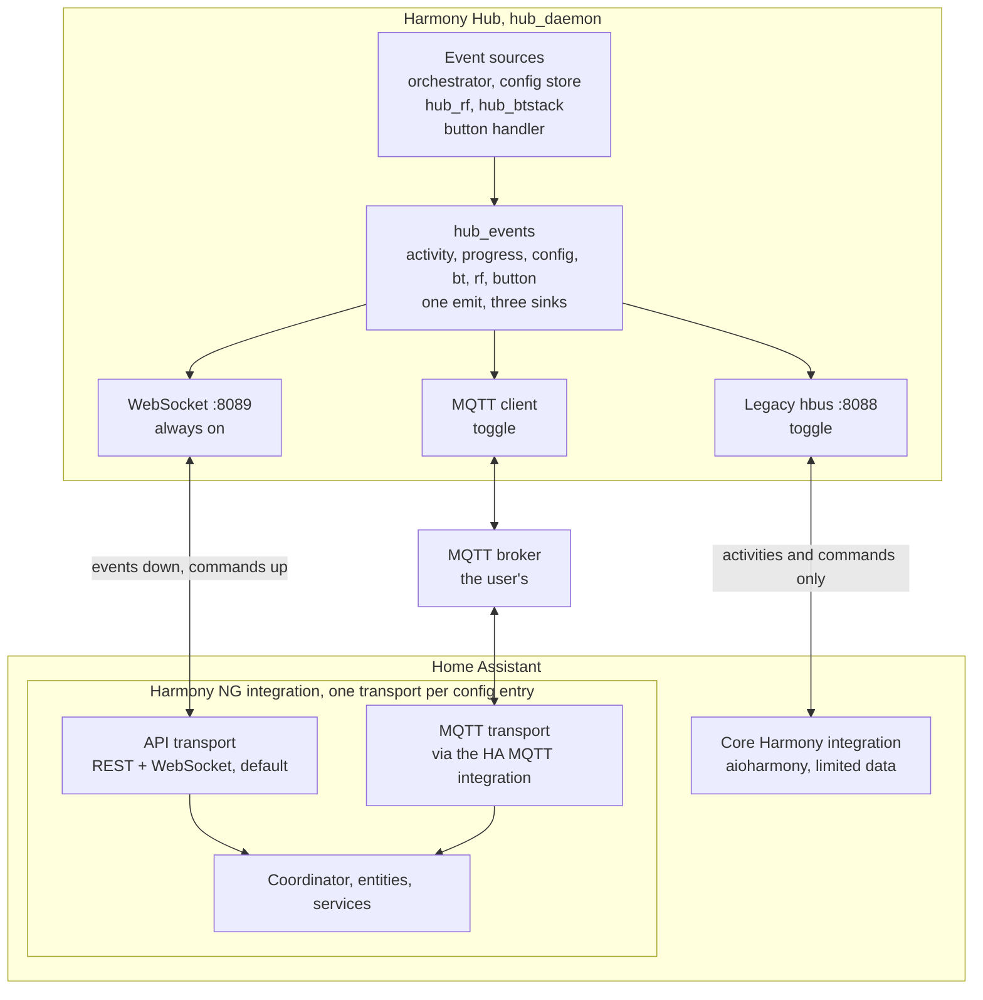

<!-- Mirror of the design document kept as a Claude Doc. Update both together. -->

# Harmony NG Integration Architecture

Design document for the Harmony NG custom integration. Last updated 2026-11-06.

The Hub's native API, REST plus one WebSocket, is the primary layer. MQTT through Home Assistant's MQTT integration is
the second full layer. The Logitech protocol on port 8088 is a firmware-only option for the core Harmony integration.
One event bus in hub_daemon feeds all three, so the two full layers carry identical information. Measured Hub resources
leave an order of magnitude of headroom.

## Requirements and constraints

The integration replaces Home Assistant's core Harmony integration for Hubs running harmony-ng, where the Logitech
protocol no longer exists. We maintain both the firmware and the integration, so the Hub side is part of the design
space.

<!-- pyml disable md013 -->

| Requirement | Meaning for the design |
| --- | --- |
| Push model, no polling | Every state change reaches Home Assistant as an event. REST is used only at startup and for commands |
| Very efficient | One socket per Hub, small JSON frames, nothing persisted to flash at runtime |
| User chooses the layer | The config flow offers API or MQTT. Both expose the same entities and services |
| Entities independent of the layer | Unique ids, entity ids and names derive from the Hub id and the entity key only. The user can switch API to MQTT or back and keep every entity, its history and its automations |
| Legacy protocol in firmware only | A Hub setting enables the Logitech WebSocket protocol so the core integration works, with its limits |
| Full functionality on each full layer | One firmware event model fans out to every transport, so no layer lags another |
| Platinum quality | All 54 quality scale rules addressed; typed PyPI client with injected session for the API layer |
| Hub resources | 29 MB RAM, idle CPU, 1.7 MB free flash. Flash is the scarce resource |
| Discovery at network level | mDNS announces the Hub. Discovery never depends on a broker |

<!-- pyml enable md013 -->

Decisions already taken: API is primary and default; MQTT is a first-class alternative consumed through Home Assistant's
MQTT integration; the Hub's own MQTT discovery entities are removed in the MQTT rewrite; the legacy shim is in the first
firmware milestone; the firmware's three transports are independent toggles while the integration uses one transport per
config entry; entity identity never encodes the transport, so the transport can be changed in place without losing
entities.

## Architecture at a glance

Every state change is emitted once into hub_events and delivered by whichever sinks are enabled. The integration binds
one transport per config entry and the same coordinator and entities sit behind both. The legacy port serves the core
integration and other Harmony clients with the stock protocol's narrower data.

## Transport comparison

For a single Home Assistant instance the Hub cannot tell the two full layers apart. The API wins on responsiveness, acks
and having no third system in the path. MQTT wins when several consumers share the events. The legacy protocol is thin
by design.

<!-- pyml disable md013 -->

| Criterion | API: REST + WebSocket | MQTT via HA MQTT integration | Legacy 8088, core integration |
| --- | --- | --- | --- |
| Push today | Activity progress only. State needs get_state. PR #74 adds BT, RF, config | Progress and buttons. Retained state republished every 30 s, not on change | Nothing exists yet |
| Push after firmware work | Complete, immediate, one socket | Complete, one broker hop | Activity state and start progress only |
| Data | Everything the Hub knows | Same, once published. Inventory needs chunked retained topics | Activities, devices, commands, current activity. No battery, BT, RF, buttons |
| Control | Request and reply with acks, 409 on busy, press, hold, release | Fire and forget today. Response topic with correlation id in the rewrite | Full remote semantics with request-id-bound progress |
| Button events | Firmware change, about 10 lines | Exist, but lost without broker and releases dropped | Not in the protocol |
| Latency | Direct LAN socket, keepalive every 30 s | One broker hop, single-digit ms on a LAN | Same socket model as API |
| Hub memory per consumer | About 12 KB per client | About 12 KB total, independent of consumers | About 12 KB per client |
| Infrastructure | None | Broker, HA MQTT integration, credentials on the Hub | None |
| Offline detection | Socket drop, HA reconnects with backoff | LWT retained status | Socket drop |
| Consumers | 16 socket clients | Unlimited through the broker | Several clients |
| Auth | REST auth exists. WebSocket upgrade unauthenticated today | Broker auth and ACLs | None in the protocol |
| Discovery | mDNS, to be added | mDNS, same record | SSDP, to be added |
| Integration code | Typed PyPI client, session injected | HA MQTT helpers, no library | None, core integration unchanged |
| Compatibility value | Our integration only | Node-RED, openHAB, any MQTT consumer | Core integration, Homey, openHAB binding, pyharmony scripts |
| Main risk | WebSocket upgrade unauthenticated until firmware milestone 1 lands | Two-place configuration; duplicate entities if Hub discovery stays on | Stock quirks must match aioharmony exactly |

<!-- pyml enable md013 -->

A fourth variant, Hub-generated MQTT discovery entities with no custom integration, is rejected. MQTT discovery has no
remote platform, every entity is C code with fixed buffers, and it cannot be scored against the quality scale.

## Firmware today

Verified on 2026-11-05 against upstream main plus the #74 and #81 branches; #74 merged upstream that day. hub_daemon is
a single select() loop with a hand-rolled HTTP and WebSocket server on port 8089, an orchestrator ticked every 40 ms, a
hand-rolled MQTT 3.1.1 client and cJSON. Paths are relative to payload/source.

<!-- pyml disable md013 -->

| Surface | What exists | What is missing or wrong |
| --- | --- | --- |
| HTTP server | Backlog 32, one detached thread per connection with a 512 KB stack, hard cap of 8 threads (hub_daemon.c:45). Digest, Bearer and PAT auth on /api/* (http_server.c:429-452). CORS * everywhere | A ninth concurrent request is refused. Static files and the WebSocket upgrade are not authenticated |
| WebSocket | RFC 6455 upgrade on any path, 16 clients (ws_server.h:7), 4 KB inbound frame buffer (hub_ws.c:51). Actions: ping, get_state, send_command with press, hold, release, start_activity, stop_activity, cancel_activity, bt_key, bt_text, bt_mouse (hub_ws.c:76-328) | Upgrade runs before the auth check (http_server.c:514-518); the token form in API.md 11.4 does not exist. No activity_state push, only activity_progress (hub_ws.c:16-48). No server keepalive. Main has no locking on the client list and no loop on partial sends |
| PR #74 | state_watch.c, 236 lines: a 1 s thread active while a client is connected, pushes bt_status, rf_status and config_changed with key files, plus mutexes, send_all and 503 at capacity | Merged upstream on 2026-11-05. Baselines reset on reconnect, so nothing is sent until the next change |
| PR #81 | POST /api/rf/wake?slot=N, 70 lines with tests | Open on the fork; folded into firmware milestone 1 |
| Orchestrator | States IDLE, STARTING, RUNNING, STOPPING; busy during STARTING and STOPPING; returns -2 when busy, mapped to HTTP 409. Progress callback at start, per step, on completion and on cancel (orchestrator.c:138-441) | The callback's only consumer is the progress broadcast. State transitions themselves are not published |
| MQTT | Reconnect backoff 5 to 60 s, LWT on status, retained state JSON, progress, button pulses on remotes/slotN/Cmd (hub_mqtt.c). Subscribes to activity/set, command/#, send_command, sync, remote sleep, pronto | Retained state only republished every 30 s or on connect (hub_mqtt.c:1070-1080). Button releases dropped (:859-861). Events lost with return -1 when the broker is down (:855). HA discovery hardcoded with fixed buffers (hub_mqtt_ha.c:196-431) |
| Button events | hub_rf posts /api/button-press (rf_keymap.c:175), dispatched to MQTT only (http_api_remotes.c:383) | No WebSocket path at all |
| Discovery | None. harmony.local appears only as a label in openapi.yaml:21-23 | No mDNS, no SSDP |
| Legacy protocol | No trace of XMPP, 8088, hbus, stateDigest or SSDP in any daemon. Only host tools probe stock port 8088 | Everything must be written |
| OpenAPI | 88 paths documented | docs/openapi.yaml fails to parse at line 1206, column 78 |

<!-- pyml enable md013 -->

Live payloads from the Hub: inventory 28 KB for 4 devices and 202 commands, activities 1 KB, rf/status 1.1 KB, bt-status
0.5 KB. The status endpoint's total_kb and free_kb report the /data flash partition, not RAM (http_api_system.c:30-38).

## Firmware plan

One module, hub_events, owns a small set of events: activity state, activity progress, config changed, BT status, RF
status, remote button. The orchestrator, the state watcher and the button handler emit into it. Three sinks subscribe:
the WebSocket broadcaster, the MQTT publisher and the legacy shim. Full functionality on every layer then holds by
construction. Line counts are estimates excluding tests, which add about a third. Reference points from the tree:
state_watch.c is 236 lines for three pushed types, the #74 WebSocket hardening is 97, the #81 wake endpoint is 70 with
tests, the MQTT discovery code is 440. Every item is specified in HA_INTEGRATION_FIRMWARE_SPEC.md in the firmware
repository's docs folder, one pull request per milestone on the fork.

<!-- pyml disable md013 -->

| Feature | Layer | Where | New lines | Notes |
| --- | --- | --- | --- | --- |
| Event bus: event struct, subscribe, emit | Shared | new hub_events.c and .h, hooks in hub_daemon.c, orchestrator.c, http_api_remotes.c | 150 to 200 | Foundation for every row below |
| Activity state event on every transition | Shared | orchestrator.c | 20 to 30 | Emit where progress already fires |
| Port the #74 watcher to the bus | Shared | existing branch | 20 to 40 | 423 lines already written |
| Remote button event with release, never dropped | Shared | http_api_remotes.c | 20 to 30 | Replaces the MQTT-only dispatch |
| hub_rf pushes RF status instead of being polled | Shared | rf_api.c, hub_daemon.c | 40 to 60 | Removes the 1 s poll in the watcher |
| Remote unit id over RF | Shared | elite_ui, rf_main.c | 60 to 100 | The remote reads its manufacturing partition and reports it; rf_status gains remote_id per slot |
| Infrared capture mode and ir_received event | API | http_api_commands.c, ir_i2s.c, ir_encoder.c | 80 to 120 | Serves the infrared receiver entity; capture pauses for sends and shares the timing representation with the encoder |
| WebSocket sink for every bus event | API | hub_ws.c | 80 to 120 | Reuses existing JSON builders |
| WebSocket auth on upgrade with PAT or Bearer | API | http_server.c, http_auth.c, ws_server.c | 40 to 60 | Closes the documented but missing token check |
| Server keepalive ping and dead-client reaping | API | ws_server.c | 30 to 50 | Clients today only drop on send failure |
| Full state snapshot on connect | API | hub_ws.c | 40 to 60 | Activity, BT, RF, config version in one frame |
| Raw IR endpoint: carrier, signed timings, port mask, repeats | API | http_api_commands.c, calls hw_ir_send_raw | 50 to 80 | Serves the infrared emitter entities. The raw path exists in hw_action.c and ir_encoder.c, only the endpoint is missing |
| mDNS responder, _harmony-ng._tcp with TXT record | Discovery | new hub_mdns.c | 200 to 300 | TXT: id, version, auth, mqtt base topic. Kernel 2.6.31 has no SO_REUSEPORT, one responder owns 5353 |
| MQTT rewrite on the bus: publish on change, retained state, BT, RF, inventory, config version | MQTT | replaces hub_mqtt.c and hub_mqtt_ha.c | 600 to 900 | Today 1542 lines. Discovery entities deleted in this change |
| MQTT command channel with correlation id and response topic | MQTT | inside the rewrite | 100 to 150 | Acks and busy errors equal to the API layer |
| MQTT button events with release, QoS 1 | MQTT | inside the rewrite | 20 to 40 | Replaces the pulse-then-zero scheme |
| MQTT inventory chunked per device | MQTT | inside the rewrite | 30 to 50 | 28 KB exceeds the 4 KB packet buffer |
| MQTT raw IR command topic | MQTT | inside the rewrite | 20 to 40 | Same payload as the API endpoint, so the emitter entities work on both transports |
| Legacy provisioning POST on 8088 | Legacy | new hbus_server.c | 40 to 60 | activeRemoteId, hubSwVersion, discoveryServer |
| Legacy WebSocket listener on the select loop | Legacy | hub_daemon.c, reuse ws_server.c | 60 to 100 | Second listener via http_server_init(port) |
| Legacy command handlers: state digest, config, current activity, holdAction, runactivity, changeChannel, sync, discovery info | Legacy | hbus_server.c | 300 to 400 | Maps onto orchestrator getters and the press, hold, release path |
| Legacy activity start sequencing: code 100 progress bound to the request id, final 200, state digest 1 then 2, startActivityFinished | Legacy | hbus_server.c as a bus sink | 100 to 150 | Without the bound 200 the core integration times out after 60 s |
| Stock config schema: activity and device lists, control groups, JSON-in-string actions, timeStampHash | Legacy | new hbus_config.c | 250 to 350 | Numeric string ids, PowerOff activity with id -1 |
| SSDP responder with device description XML | Legacy | new hub_ssdp.c | 150 to 250 | Shares UDP plumbing with mDNS |
| Settings and web UI toggle, off by default | Legacy | config_store.c, http_api_system.c, frontend | 40 to 80 | Plus the OpenAPI entry |
| OpenAPI file fix | Docs | docs/openapi.yaml | 1 | Line 1206 |

<!-- pyml enable md013 -->

<!-- pyml disable md013 -->

| Milestone | New lines |
| --- | --- |
| Shared event model and API layer | 680 to 1010 |
| mDNS | 200 to 300 |
| MQTT rewrite | 770 to 1180 |
| Legacy shim with SSDP and toggle | 940 to 1390 |
| Everything | 2610 to 3840 |

<!-- pyml enable md013 -->

The event bus lands first, since every other row emits into it or consumes it. The shim should be verified against a
recorded aioharmony session, not only against the core integration, because the core integration tolerates silence on
most commands and would hide framing mistakes that other Harmony clients will not.

## Hub resource budget

The whole programme adds under 300 KB of steady-state RAM, under 1 MB at peak and 50 to 90 KB of flash on a Hub with 21
MB of RAM available and an idle CPU. Flash is the only tight resource, which sets the rule that all new code lives
inside hub_daemon.

Baseline measured on 2026-11-05 on a Hub with one activity running and no WebSocket client connected. The stock Logitech
runtime used 12 to 16 MB and 15 to 30 percent CPU on the same hardware.

<!-- pyml disable md013 -->

| Resource | Measured | Source |
| --- | --- | --- |
| SoC | Atheros AR9344, MIPS 24Kc, kernel 2.6.31 | /api/system-info |
| RAM total / available | 29 MB / 21 MB | /proc/meminfo |
| Load average | 0.00, 41 processes | /api/system-info |
| hub_daemon resident | 908 KB, 2 threads, 468 KB text | /proc/pid/status |
| hub_rf resident | 324 KB, 6 threads | /proc/pid/status |
| hub_btstack resident | 560 KB, 1 thread | /proc/pid/status |
| hub_daemon binary | 516 KB, static, built with -Os -s | release bundle |
| /data flash | 1712 KB free of 5120 | df |
| /cache flash | 1756 KB free of 5120 | df |
| Inventory payload | 28 KB, 4 devices, 202 commands | /api/inventory |

<!-- pyml enable md013 -->

<!-- pyml disable md013 -->

| Feature | RAM | Flash | CPU | Fit |
| --- | --- | --- | --- | --- |
| Event bus | Under 2 KB static | 3 to 6 KB | Nil, calls on the existing 40 ms loop | Fits |
| State push, button events, snapshot on connect | A few KB transient per event via cJSON | 2 to 4 KB | Nil | Fits |
| WebSocket sink, auth, keepalive | About 12 KB per client; 16 clients about 200 KB worst case | 3 to 6 KB | One ping per client every 30 s | Fits. Runs on the select loop, not the 8 HTTP threads |
| State watcher as in #74 | One thread, 1 s file poll plus an HTTP call to hub_rf while a client is connected | 0 | Small, constant | Fits. Pushing from hub_rf removes the poll |
| mDNS responder | One UDP socket, 1500 byte buffer | 8 to 15 KB | Answers on queries only | Fits |
| MQTT rewrite | 4 KB packet buffer, 32 subscriptions, as today | Net zero or negative | Lower than today: publish on change, not on a timer | Fits. Inventory chunked per device |
| Legacy listener and handlers | Same per-client cost as WebSocket | 15 to 25 KB | Nil | Fits |
| Legacy config generation | 40 to 60 KB of JSON for 202 commands; cJSON tree peaks at 150 to 300 KB, freed after send | Included | A few ms per config request, once per client connect | Fits. Build on demand, never cache |
| SSDP responder | Shares UDP plumbing; 1 KB description XML | 6 to 10 KB | Nil | Fits |

<!-- pyml enable md013 -->

Three rules follow from the measurements. All new code goes inside hub_daemon, because a separate static MIPS binary
costs about 100 KB of flash for its libc copy alone, as the 104 KB DHCP daemon shows, while code added to hub_daemon
costs 1 to 2 KB per 100 lines. Nothing in the bus, the shim or the MQTT layer writes flash at runtime; only user
settings persist. Push and the shim stay on the select loop, since the 8-thread HTTP cap refuses a ninth request; the
512 KB stacks are virtual, not resident, so they are not a memory problem.

The peak case to test on hardware before merging is 16 socket clients plus a legacy config request during an activity
switch, which exercises every transient allocation at once.

## Integration design

One entity model, two interchangeable backends. Entities, services and devices never know which transport is active.

**Transport abstraction.** A HarmonyNgTransport protocol class with async connect, disconnect, fetch_snapshot,
start_activity, power_off, cancel, send_command with press, hold and release, bt_key, ir_raw, rf_wake, sync, and an
event callback. Two implementations: ApiTransport wraps the PyPI client (REST plus WebSocket); MqttTransport subscribes
and publishes through homeassistant.components.mqtt and correlates command responses by id. Both transports serve the
full entity set. A transport still reports capabilities so that an older firmware missing a feature degrades by leaving
the affected entity registered and unavailable, never by deleting it.

**Coordinator.** A DataUpdateCoordinator with no update_interval. Every transport event calls async_set_updated_data
from a callback. The coordinator holds one HubState dataclass: activity id and state, busy and sending, inventory with
config version, BT hosts, RF slots with battery and sync, firmware and version. REST or a retained-topic read happens
once at setup and again on a config_changed event. A missed-heartbeat watchdog marks the entry unavailable and
reconnects with backoff.

**Config flow.** Steps: discovered Hub or manual host and port; optional Personal Access Token, validated by one status
call; transport choice with API as default and MQTT as the alternative, shown with conditional fields for the MQTT base
topic prefilled from the Hub's TXT record or status call. Reauth flow for an invalidated token. Reconfigure flow for
host and transport. Options flow with reload for default activity and inter-command delay, the two options core users
already have. Unique id is the Hub's stable id from the TXT record or status call, never the host.

**Changing transport.** The transport is a setting of the config entry, never part of any identity. The reconfigure flow
lets the user switch between API and MQTT: it validates the new transport against the same Hub id, refuses a Hub whose
id differs, writes the new transport into entry data and reloads the entry. The config entry id, the device identifiers,
every unique id and therefore every entity id, friendly name, history, area, label and automation stay untouched,
because none of them ever contained the transport, host, port or base topic. No migration step exists by design: a
transport change behaves exactly like a host change. The one real migration is for users of the Hub's old MQTT discovery
entities, which live under the mqtt domain: the MQTT rewrite stops publishing them, and the integration offers a repair
that removes the orphaned mqtt entities and lists their replacements so automations can be repointed.

**Discovery.** mDNS only, service _harmony-ng._tcp, TXT keys id, ver, api, auth, mqtt, topic, legacy, name. The flow
updates the stored host when a known id appears on a new address. No MQTT-triggered discovery.

**Library split.** A typed package pyharmonyng on PyPI holds the API client: aiohttp session injected, REST models,
WebSocket listener with reconnect, exceptions, py.typed. It has no Home Assistant imports and its own tests. The MQTT
backend lives inside the integration because it is Home Assistant specific. This satisfies the three Platinum rules for
the API layer and keeps the MQTT layer exempt from inject-websession with a documented reason.

**Repo layout.** custom_components/harmony_ng with __init__.py, config_flow.py, const.py, coordinator.py, entity.py,
transport/ (base.py, api.py, mqtt.py), remote.py, select.py, sensor.py, binary_sensor.py, button.py, event.py,
infrared.py, diagnostics.py, repairs.py, services.py, icons.json, translations/en.json, quality_scale.yaml, brand/.
tests/ mirror the modules with snapshot tests per platform.

**Services.** Entity services on the remote entity: send_command with device, delay_secs, hold_secs and num_repeats as
in core, plus sync. Integration services registered in async_setup: ir_send for a device command by name with port and
repeats; raw codes go through the infrared emitter entities instead, bt_key with key and action, activity_help and
activity_cancel. All raise translated HomeAssistantError on failure and return response data where useful.

**Error handling.** The library raises typed exceptions: HarmonyNgConnectionError, HarmonyNgAuthError,
HarmonyNgBusyError for 409, HarmonyNgApiError. The coordinator maps them to ConfigEntryAuthFailed, ConfigEntryNotReady
or UpdateFailed and never logs what Home Assistant logs itself.

**Compatibility with core automations.** The remote entity keeps the same attribute names, activity_list semantics and
PowerOff handling as core, so turn_on with activity, turn_off and send_command port unchanged. Entity ids differ by
domain, which a rename at migration time covers.

## Entity and device model

One Hub device, one child device per RF remote slot, and the same entity set on either transport. Every entity sets
has_entity_name and takes its name from a translation key, never from the device name. Unique ids are the Hub id plus
the entity key, with the remote id for per-remote entities and the host address for per-Bluetooth-host entities; device
identifiers are the Hub id alone. Neither carries the transport, host, port or MQTT base topic, so API and MQTT produce
identical registry entries and switching between them changes nothing in the entity registry.

<!-- pyml disable md013 -->

| Device | Identifier | Relationship | Fields |
| --- | --- | --- | --- |
| Hub | (harmony_ng, hub id) | Root device of the config entry | manufacturer Logitech, model Harmony Hub, model_id from skin, sw_version harmony-ng version, hw_version Logitech base firmware, configuration_url `http://host:8089`, serial_number hub id |
| RF remote, one per paired remote | (harmony_ng, remote id), the remote's own unit id read from its manufacturing partition and reported over RF; the slot number is an attribute | via_device_id to the Hub, since it is a separate product with its own firmware and battery | model from the slot (Elite, Ultimate), sw_version remote firmware |
| Configured IR or BT device | (harmony_ng, hub id:device:id), a child device of the Hub | One remote entity per device for send_command without naming the device; added and retired as the inventory changes | name, manufacturer, model from the inventory |

<!-- pyml enable md013 -->

<!-- pyml disable md013 -->

| Platform | Entity | Source | Device | Category | Notes |
| --- | --- | --- | --- | --- | --- |
| remote | Hub remote | activity state, inventory | Hub | main entity, name None | turn_on with activity, turn_off, send_command with device, delay_secs, hold_secs, num_repeats; attributes current_activity, activity_list, last_activity, activity_starting, devices_list as in core |
| select | Activity | activity state, inventory | Hub | none | options PowerOff plus activity names, same as core |
| sensor | Activity state | orchestrator state | Hub | diagnostic | enum: idle, starting, running, stopping |
| sensor | Firmware | status | Hub | diagnostic | harmony-ng version string |
| sensor | Uptime | status | Hub | diagnostic, disabled by default | timestamp device class |
| sensor | Battery | rf_status | Remote slot | diagnostic | device class battery, percent |
| sensor | Battery voltage | rf_status | Remote slot | diagnostic, disabled by default | voltage device class, millivolts |
| binary_sensor | Charging | rf_status | Remote slot | diagnostic | device class battery_charging |
| binary_sensor | Config in sync | rf_status | Remote slot | diagnostic | problem device class, inverted |
| binary_sensor | Hub busy | activity state | Hub | diagnostic | running device class |
| binary_sensor | Bluetooth host connected, one per paired host | bt_status | Hub | diagnostic | connectivity device class, dynamic add and remove |
| button | Power off | command | Hub | none | same as the Hub's MQTT button today |
| button | Sync remotes | command | Hub | config | push-config |
| button | Wake remote | command, PR #81 | Remote slot | config | per slot |
| button | Sleep remote | command | Remote slot | config | per slot |
| button | Cancel activity | command | Hub | config | resets a stuck interlock |
| event | Remote button | button events | Remote slot | none | event types press and release with the button name as attribute; uses the standard button event types |
| update | Hub firmware | update-status endpoints | Hub | config | first release; installed version from the status, latest from the Hub's release check polled daily; install calls update-apply and the Hub restarts |
| infrared | IR emitter, one per output: front blaster, jack 1, jack 2 | raw IR endpoint | Hub | none | first release; subclasses InfraredEmitterEntity; Home Assistant supplies raw timings and a carrier, the Hub never sees Pronto; lets core IR integrations such as lg_infrared or samsung_infrared use the Hub as their blaster |

<!-- pyml enable md013 -->

Services beyond the remote entity's own: harmony_ng.ir_send (device and command by name, with port and repeats),
harmony_ng.bt_key (key, action press, hold, release, target), harmony_ng.activity_help and harmony_ng.activity_cancel.
All target the Hub device and raise translated errors.

Diagnostics redact the host, token and Bluetooth addresses and include the last snapshot, the transport in use, the Hub
version and the configured mDNS record. Repair issues cover: firmware too old for the event bus, legacy mode enabled on
the Hub while our integration is configured, and the Hub's MQTT discovery entities still present.

## Quality scale plan

All 54 current rules are addressed. For custom integrations the tier is self-declared: hassfest skips quality_scale.yaml
for non-core code and the Marketplace states there are no tiers for custom integrations, so the file is our own tracking
and the manifest key documents the claim. Only four rules are exempt, each with a justification the rule page accepts.

<!-- pyml disable md013 -->

| Tier | Rules | Plan |
| --- | --- | --- |
| Bronze, 20 | action-setup, appropriate-polling, brands, common-modules, config-flow, config-flow-test-coverage, dependency-transparency, docs-actions, docs-conditions, docs-high-level-description, docs-installation-instructions, docs-removal-instructions, docs-triggers, entity-event-setup, entity-unique-id, has-entity-name, runtime-data, test-before-configure, test-before-setup, unique-config-entry | All done. appropriate-polling is satisfied by having no polling. brands via the custom brand folder. docs rules written against the README and docs folder |
| Silver, 10 | action-exceptions, config-entry-unloading, docs-configuration-parameters, docs-installation-parameters, entity-unavailable, integration-owner, log-when-unavailable, parallel-updates, reauthentication-flow, test-coverage | All done. reauthentication-flow is required because auth is optional, not absent: an invalidated PAT triggers reauth. parallel-updates 0 on read-only platforms, 1 on remote, select, button |
| Gold, 21 | devices, diagnostics, discovery, discovery-update-info, docs-data-update, docs-examples, docs-known-limitations, docs-supported-devices, docs-supported-functions, docs-troubleshooting, docs-use-cases, dynamic-devices, entity-category, entity-device-class, entity-disabled-by-default, entity-translations, exception-translations, icon-translations, reconfiguration-flow, repair-issues, stale-devices | All done; mDNS shipped with firmware milestone 2. dynamic-devices and stale-devices are required, not exempt, because remote slots and Bluetooth hosts come and go: listener-based adds and async_remove_config_entry_device |
| Platinum, 3 | async-dependency, inject-websession, strict-typing | async-dependency and strict-typing done via the typed asyncio library with py.typed. inject-websession done for the API transport. For an entry on the MQTT transport the rule is exempt: no HTTP session exists, which is the exception the rule page names |

<!-- pyml enable md013 -->

<!-- pyml disable md013 -->

| Rule | Status | Justification |
| --- | --- | --- |
| discovery, discovery-update-info | todo until mDNS lands, then done | The Hub does not announce itself today; firmware milestone 1 adds the record |
| inject-websession | done for API, exempt for MQTT | The MQTT transport makes no HTTP requests |
| infrared platform entity | first release | Not a scale rule, listed for completeness. The platform hands the emitter raw timings and a carrier, so no Pronto mapping is involved; the firmware raw send path exists and only needs an endpoint |
| update entity | deferred | update-apply needs validation on hardware before Home Assistant can trigger it |

<!-- pyml enable md013 -->

Test coverage target is 97 percent per the repository rule, above the 95 percent the scale asks for. Snapshot tests per
platform, a config flow test per step and error, a diagnostics snapshot, and transport tests that replay recorded Hub
frames for both backends.

## Home Assistant platform changes to apply first

Home Assistant 2026.11.0 shipped on 2026-11-04. The integration targets a minimum of 2026.8.0, which stays valid, but
the shared scaffolding that integration repositories are generated from must be updated before this integration is built
on it. Entity naming rules in code did not change; the frontend now composes device and entity names, so entity names
must never carry the hub or device name.

<!-- pyml disable md013 -->

| Change | Since | Deadline | Action in the scaffolding |
| --- | --- | --- | --- |
| HACS replaced by the built-in Marketplace, same catalog and hacs.json | 2026.11 | now | README and install docs say Marketplace; add the categories manifest key; keep version in the manifest |
| pytest-homeassistant-custom-component declared broken; official pytest-homeassistant from core | 2026.11 | now | Switch the dev dependency and imports; match the package version to the HA version |
| Developer docs moved to contributors.home-assistant.io | 2026-10-16 | redirects for now | Update links in CLAUDE.md and docs |
| Config entry functions return None; failure by raising | 2026.11 | bool still accepted | Return None, use async_unload_platforms_or_raise; tests patch setup with return_value None |
| DeviceInfo is a dataclass, keyword-only, via_device_id, no default_ fields | 2026.11 | via_device removed 2027.8 | Construct with keywords; resolve the parent registry id for via_device_id |
| async_get_device deprecated | 2026.8 | 2027.8 | Use async_get_device_by_identifier with the entry id |
| step_id required on every form, menu and progress result | 2026.10 | 2027.5 | Pass step_id everywhere |
| In-place entity id changes | 2026.11 | compat removed 2027.11 | Base entity implements async_entity_id_changed |
| Repair issues bound to a config entry | 2026.11 | none | Pass config_entry_id; use async_refresh_issues |
| Update listener combined with reload-on-update flows | 2026.6 | error from 2026.12 | Keep OptionsFlowWithReload, drop add_update_listener |
| Central abort reasons translated by core | 2026.10 | none | Remove already_in_progress, reauth_successful, reconfigure_successful, single_instance_allowed from abort translations |
| Conditional form fields with visible | 2026.11 | none | Use for the transport step |
| Child devices | 2026.9 | none | Optional for configured IR and BT devices; remotes stay via_device_id |
| Undefined sentinel replaces UNDEFINED | 2026.12 | none | Migrate when the floor reaches 2026.12 |
| Custom brand images | 2026.3 | none | Keep the brand folder |
| Probatio replaces voluptuous | 2026.9 | none | No code change; error text in tests may differ |
| Entity service registration helper | 2025.10 | hass arg removed 2026.10 | Use async_register_platform_entity_service |
| infrared and radio_frequency entity platforms | 2026.4, 2026.5 | Platform split into InfraredEmitterEntity and InfraredReceiverEntity; the old InfraredEntity name is a deprecated alias removed in 2027.6. Subclass InfraredEmitterEntity directly | infrared emitter in the first release, one entity per output. Receiver later at most: ir_i2s.c can capture, but nothing exposes it and capture has to release the transmit handle. radio_frequency not applicable: the platform models sub-GHz OOK transmitters, the CC2544 is a 2.4 GHz packet radio speaking eQuad to the remotes |
| Quality scale not validated for custom integrations | current | none | Keep quality_scale.yaml for tracking; declare the tier in the manifest |

<!-- pyml enable md013 -->

The changes above belong to the shared scaffolding rather than to this integration, so they are a separate piece of work
and should land first.

## Milestones and sequencing

Firmware leads by one milestone, because the integration's API transport needs the event bus and the state push before
it can be tested end to end. The scaffolding update is independent and lands first.

1. Scaffolding: apply the Home Assistant platform changes to the shared integration scaffolding so every repository
   generated from it receives them.
2. Firmware milestone 1: event bus, activity state push, the #74 watcher ported, button events, WebSocket auth,
   keepalive, snapshot on connect, raw IR endpoint, mDNS, legacy shim with SSDP and toggle, OpenAPI fix. Verified on the
   Hub with a recorded aioharmony session and the core integration.
3. Library: pyharmonyng on PyPI with REST models, WebSocket listener, typed exceptions and its own tests against
   recorded frames.
4. Integration milestone 1: API transport, config flow with mDNS, remote, select, sensors, binary sensors, buttons,
   event, infrared emitters, diagnostics, repairs, services. Platinum rules done except MQTT-specific ones.
5. Firmware milestone 2: MQTT rewrite on the bus, command response topics, raw IR command topic, chunked inventory,
   discovery entities removed, release note naming the integration as the replacement.
6. Integration milestone 2: MQTT transport, transport step in the config flow, parity tests that run the same entity
   snapshots on both backends.
7. Integration milestone 3: update entity, infrared receiver (needs the firmware's capture item), child devices with a
   remote per configured device. Written ahead of the firmware; the receiver stays unavailable until the Hub lists
   ir_capture.

<!-- pyml disable md013 -->

| Decision | Taken |
| --- | --- |
| Primary layer | API, default in the config flow |
| Second full layer | MQTT through Home Assistant's MQTT integration: the Hub publishes to the broker, the integration subscribes |
| Legacy protocol | Firmware-only setting, off by default, in milestone 1; the core integration is the client |
| Hub MQTT discovery entities | Removed in the MQTT rewrite, with a release note |
| Discovery | mDNS only; the transport is chosen in the flow, never implied by how the Hub was found |
| Firmware transports | Independent toggles; WebSocket always on for the web UI |
| Integration transports | One per config entry |

<!-- pyml enable md013 -->

Open questions: whether configured IR and BT devices become child devices in the first release or later. The PyPI name
pyharmonyng was free on 2026-11-06.

## Sources

- harmony-ng firmware repository, main at f44074d (includes #74) plus branch feat/rf-wake (#81):
  payload/source, docs/API.md, docs/openapi.yaml, README.md.
- Readings taken on 2026-11-05 from a Hub running harmony-ng main: GET /api/status, /api/system-info, /api/inventory,
  /api/activities, /api/rf/status, /api/bt-status, plus /proc/meminfo, /proc/pid/status and df from a shell on the Hub.
  Read-only.
- aioharmony tag v1.0.8, ehendrix23/aioharmony: harmonyclient.py, hubconnector_websocket.py, hubconnector_xmpp.py,
  const.py, responsehandler.py. [GitHub](https://github.com/ehendrix23/aioharmony)
- Home Assistant core 2026.9.3 source: homeassistant/components/harmony, mqtt, infrared, radio_frequency, remote.
- [Home Assistant 2026.11 release notes](https://www.home-assistant.io/blog/2026/11/04/release-202611/),
  [2026.10](https://www.home-assistant.io/blog/2026/10/07/release-202610/),
  [2026.9](https://www.home-assistant.io/blog/2026/09/02/release-20269/).
- [Developer blog index](https://contributors.home-assistant.io/blog/), posts from 2025-11-01 to 2026-11-05.
- [Integration quality scale](https://contributors.home-assistant.io/core/quality-scale/) and
  [rules](https://contributors.home-assistant.io/core/quality-scale/rules/).
- [Entity naming](https://contributors.home-assistant.io/core/entities/naming/) and [Naming things in Home
  Assistant](https://www.home-assistant.io/blog/2026/11/03/naming-things-in-home-assistant/).
- [Marketplace integration guide](https://contributors.home-assistant.io/marketplace/guides/integrations/) and
  [hacs.json reference](https://contributors.home-assistant.io/marketplace/reference/hacs-json/).
- [pytest-homeassistant on PyPI](https://pypi.org/project/pytest-homeassistant/) and the
  [pytest-homeassistant-custom-component notice](https://github.com/MatthewFlamm/pytest-homeassistant-custom-component).
- [hassfest quality_scale.py in core
  2026.11.0](https://raw.githubusercontent.com/home-assistant/core/2026.11.0/script/hassfest/quality_scale.py).
